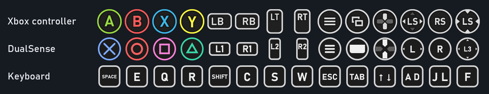
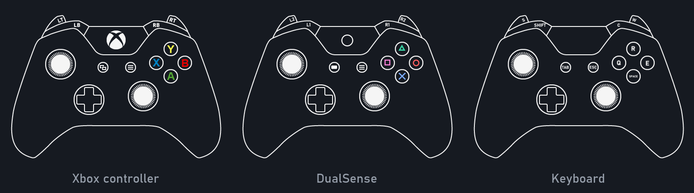

# FH2-Input

The PlayStation 5 controller (DualSense, DualSense Edge), the keyboard and the mouse for **Forza Horizon 2 on the
Azimuth emulator** (0.9.10 and 1.0.x): HD haptics and adaptive triggers driven by the car and the road, PS5-like menu
haptics, the light bar and LEDs, gyro steering, the keyboard as a gamepad, mouse look, and button icons that follow
the device you play with. One DLL, with or without Forza Horizon 2 Extra Options: no drivers, Steam Input or
DS4Windows. Formerly FH2-DualSense.





## Features
- **Controller**: USB or Bluetooth; Edge paddles and Fn buttons; touchpad click and swipes; gyro steering (mic button).
- **Keyboard**: a gamepad of its own, merged with the DualSense: smooth steering and pedals, the buttons, the D-pad
  and looking around, on keys of your choice (`[Keys]`). It joins the game at the first key press. Extra Options'
  own keys (F1-F4, Tab) keep working beside it. The defaults:

  | Gamepad | Keys | Gamepad | Keys |
  |---|---|---|---|
  | Throttle / brake (RT / LT) | W / S | A / B | Space, Enter / E, Backspace |
  | Steering (left stick) | A / D | X / Y | Q / R |
  | Look around (right stick) | J L I K | LB / RB | Left Shift / C |
  | D-pad | arrow keys | Menu / View | Esc / Tab |
  | Stick clicks (L3 / R3) | F / V | | |
- **Mouse**: driving, it looks around (the right stick, on top of the keys). The view goes where you move the mouse,
  like the game's look on the stick, and comes back to the front when the mouse is still; or the stick follows the
  mouse's speed, as a free camera (`[Mouse] Look=Speed`). In the menus (whenever the car is not being driven) it moves
  the left stick -- the map's cursor, the lists -- and the wheel scrolls (D-pad up/down, or LB/RB for the tabs:
  `[Mouse] Wheel`), the left button is A (confirm) and the right one B (back). Driving, the buttons do only what
  `[Keys]` gives them (`Mouse1`..`Mouse5`; nothing by default). Raw input, so it keeps going at the screen's edge;
  the cursor stays in the game's window while it is in front. The game has no pointer of its own: the mouse works
  through the gamepad's controls.
- **Button icons that follow the device in use**, as you go: PlayStation symbols for the DualSense, key caps with your
  keys for the keyboard, the game's own for an Xbox controller -- in the prompts, the menus and the controls screen.
  Or always one of them (`[Icons] Mode`).
- **Adaptive triggers**: L2 is a brake pedal that pulses like ABS at the grip limit, or goes hard when a wheel locks
  without ABS (told from how the brakes behave); R2 vibrates with wheel spin and knocks on the rev limiter; gear
  changes knock, crashes and landings jolt, and the road's texture is felt in the trigger you press.
- **HD haptics** (USB): the engine's hum, the road under each side of the car (gravel, dirt, grass, sand, cobbles,
  kerbs), crashes and landings. Over Bluetooth: the controller's rumble emulation.
- **Menu and event haptics**: ticks and clicks in the menus, the prize drum ticking by, skills, combos, checkpoints,
  countdowns, level-ups.
- **Lights**: light bar (impacts, revs or battery), player LEDs as a rev counter and skill combo, PS button shows the
  battery.
- **Settings in the game's own menu**: Settings > Controls, below the game's rows, in every language the game has,
  with the controller's state (connection, battery, firmware) and tests of the vibration, triggers and lights.
- **Nothing written into the game's folder**: what the mod gives the game is made from the game's own files into
  `DualSense\cache\` next to `azimuth.exe`.

## Requirements
- Windows 10 or 11, x64.
- Forza Horizon 2 for Xbox One on **Azimuth** 0.9.10 or 1.0.x. Neither is included.
- Optional: **Forza Horizon 2 Extra Options** (its `winmm.dll` next to `azimuth.exe`). With it, the mod hooks the game
  only after Extra Options has made its patches; its media overrides, mods and keys work as before.

## Installation
1. Download `FH2-Input-<version>.zip` from [Releases](../../releases) and unpack it anywhere.
2. Close Azimuth and run **`Install.cmd`**. It finds Azimuth (or asks for the folder with `azimuth.exe`) and puts
   `d3d12.dll` next to `azimuth.exe`. Another mod's `d3d12.dll` already there (ReShade and the like) is kept as
   `d3d12_next.dll` and keeps working; older versions of this mod are moved out of the way.
3. Turn off Steam's PlayStation controller support for Azimuth and close DS4Windows (with HidHide, allow
   `azimuth.exe`).
4. Start Azimuth, then the game. The main settings are in Settings > Controls; all of them are in
   `DualSense\DualSense.ini` next to `azimuth.exe`, and the log is `DualSense\DualSense.log`.

By hand: copy `d3d12.dll` next to `azimuth.exe`. Upgrading from 3.0: the files 3.0 wrote into the game's
`Mount\mediaoverride\` are taken away at the first start (if they are as 3.0 left them).

## Uninstalling
Run **`Uninstall.cmd`** (or delete `d3d12.dll` and the `DualSense\` folder next to `azimuth.exe`). The game and Azimuth
were never changed.

## How it works
- `azimuth.exe` loads `d3d12.dll` from its own folder; every Direct3D 12 call is passed on to the system's (or to
  `d3d12_next.dll`). Azimuth's code is not changed.
- The DualSense, the keyboard and the mouse are handed to the game as one Windows.Gaming.Input gamepad through
  Azimuth's own GamepadAdded handler, found by the code that registers it. The mouse's movement comes as raw input
  to a hidden window of the mod's own (neither Azimuth nor Extra Options takes raw input).
- The settings page, its texts and the icons in three looks (Xbox, PlayStation, keyboard) are made once from the
  game's own files into `DualSense\cache\`, and given to the game when Azimuth opens the originals: its imports of
  `CreateFileW`, `GetFileAttributesW`, `GetFileAttributesExW` and `FindFirstFileExW` go through the mod. The three
  looks of an icon archive have the same layout, so a switch gives the new look to every later read and writes it
  over the icons already in the game's memory; the engine uploads them again.
- Car data, wheel surfaces and interface sounds come from hooks into the game (MinHook), found by code signatures and
  checked before use; anything unexpected is logged and left out. The game is known by its exe's export name and
  its own marker (Forza Horizon 3 on the same Azimuth is left alone: there the mod is only a gamepad). With Extra
  Options the hooks go in only after it reports that its patches are in (`Fh2TweaksStatus()` says `OK`).

## Building
```
set FH2_GAME=D:\Games\Forza Horizon 2
build.cmd            builds out\d3d12.dll and the release (out\release\, out\FH2-Input-<version>.zip)
build.cmd install    also installs it (set AZIMUTH=<folder> if it is not found)
tools\test\run.cmd   the mod without the game: the files it gives, the icon switch in memory, the game's exe known
python -I tools\readme_images.py %TEMP%\fh2dualsense_test\DualSense\cache\png docs    the pictures above
```
Needs zig (`python -m pip install ziglang`). The PlayStation pictures need Python with numpy and Pillow and the
game's files; without them the DLL is built without pictures of its own. The tests also need the game's files.

## Credits
- DualSense report layouts: the Linux kernel's `hid-playstation` driver.
- Adaptive trigger effects: Nielk1's DualSense trigger effect notes (MIT).
- Hooks: [MinHook](https://github.com/TsudaKageyu/minhook) by Tsuda Kageyu (BSD 2-Clause, `third_party/minhook`).
- Notes on the game: the [FH2 Mod Platform](https://github.com/Trinculo54/FH2-Mod-Platform) by Trinculo54 (MIT).
- Forza Horizon 2 Extra Options by Arthur (RokkuDayo).

## Disclaimer
Not affiliated with or endorsed by Microsoft, Playground Games, Turn 10 Studios, the Azimuth developers, the Extra
Options author or Sony Interactive Entertainment. Forza Horizon, Xbox, PlayStation and DualSense are trademarks of
their owners. No game files are included.
